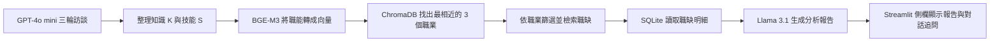

# 大學生就業指南互動平台

這是一項人工智慧跨域應用專題，為尚在探索職涯方向的大學生設計。平台透過三輪中文問答，從使用者的背景、興趣與經驗整理出職能，再用檢索增強生成（RAG）將這些職能連結到具體的職業與職缺，讓使用者有候選職缺可進一步了解。

## 資料來源與範圍

原型以科學、技術、工程與數學（STEM）職能及工程類研發職缺為主。專案內附的 `job.db` 收錄以下資料。

| 資料來源 | 收錄範圍 | 筆數 |
| --- | --- | ---: |
| 勞動部勞動力發展署的職能基準 PDF，經 Python 擷取整理。[iCAP 職能發展應用平台](https://icap.wda.gov.tw/ap/index.php) | 職業、工作描述、職能內涵 K（知識）與 S（技能） | 79 |
| 透過爬蟲蒐集的職缺資料。[104 人力銀行](https://www.104.com.tw/) | 工程類研發職缺，含工作內容、學經歷要求、地點、待遇及連結 | 2,198 |

整理後的資料存入 SQLite。程式以 `BAAI/bge-m3` 將文字轉為向量，並將職能與職缺分別存入本機 ChromaDB 的 `competency` 與 `job_104` 集合。

## 系統流程



1. **職能訪談**。GPT-4o mini 依照 SQLite 中的職能資料，每次提出一個開放式問題。訪談提示詞設計為三輪，接著從回答中整理出知識（K）與技能（S）。
2. **兩階段檢索**。先在 ChromaDB 的 `competency` 集合找出最相近的三個職業，再以這些職業篩選 `job_104` 集合，檢索相近職缺並從 SQLite 讀取明細。
3. **分析報告與追問**。本機 Ollama 的 Llama 3.1 根據訪談、職能清單與檢索結果生成報告。報告會顯示在 Streamlit 側欄，可在對話中追問職缺內容、應徵條件或公司連結。

訪談階段的對話會送往 OpenAI API。報告與後續問答由本機 Ollama 處理。

## 快速開始

以下命令適用於 Windows PowerShell。請先安裝 Git、64 位元 Python 3.10 和 [Ollama for Windows](https://docs.ollama.com/windows)，並準備具備 `gpt-4o-mini` 存取權限的 OpenAI API 金鑰。Clone 時需要使用可存取此私人 repo 的 GitHub 帳號。

### 1. 取得專案並安裝依賴

```powershell
git clone https://github.com/bloodtrail0511/RAG.git
Set-Location RAG
py -3.10 -m venv .venv
.\.venv\Scripts\python.exe -m pip install -r requirements.txt streamlit==1.38.0 openai==1.44.0 ollama==0.3.3
```

`requirements.txt` 記錄了 ChromaDB、FlagEmbedding 與 PyTorch 等依賴。安裝指令同時補上 Streamlit 介面使用的 `streamlit`、`openai` 和 `ollama`。

### 2. 準備模型並啟動介面

開啟 Ollama，並在專案根目錄執行下列指令。把 `<你的 OpenAI API 金鑰>` 換成自己的金鑰，供目前的 PowerShell 工作階段使用。

```powershell
ollama pull llama3.1
$env:OPENAI_API_KEY = '<你的 OpenAI API 金鑰>'
.\.venv\Scripts\python.exe -m streamlit run streamlit_test3.py
```

打開終端機顯示的 `Local URL`，預設為 `http://localhost:8501`。首次執行時，FlagEmbedding 需要從 Hugging Face 下載 [BAAI/bge-m3](https://huggingface.co/BAAI/bge-m3)。專案已包含 SQLite 資料及 ChromaDB 索引，可直接使用。

可以從「我是資管系大四生，做過 Python 資料分析專題，也喜歡把分析結果做成儀表板」開始，再根據畫面中的提問補充經驗。報告產生後，可以追問推薦職缺的工作內容、應徵條件或職缺連結。

## 主要檔案

| 檔案或目錄 | 用途 |
| --- | --- |
| [`streamlit_test3.py`](streamlit_test3.py) | 職能訪談、報告與追問的網頁入口 |
| [`職業內涵5_整體流程.py`](職業內涵5_整體流程.py) | 在終端機執行訪談、檢索與報告流程 |
| [`Database_sqlite.py`](Database_sqlite.py)、[`Database_chroma.py`](Database_chroma.py) | SQLite 查詢、文字向量化與 ChromaDB 檢索 |
| [`job.db`](job.db) | 職能與職缺的 SQLite 關聯式資料庫 |
| [`Database/`](Database/) | `competency` 和 `job_104` 的 ChromaDB 向量索引 |
| [`example.py`](example.py) | SQLite 條件查詢和 ChromaDB 向量查詢範例 |
| [`store_competency.py`](store_competency.py)、[`update_job_104.py`](update_job_104.py) | 將職能資料及已分類的職缺寫入索引 |
| [`other code/`](other%20code/) | 資料蒐集、匯入及模型測試腳本 |

## 專題成果與限制

- 專題測試完成了從 AI 訪談、職業與職缺檢索，到側欄顯示報告及後續問答的流程。
- 報告記錄的問題包括介面偶爾跑版、模型可能產生不存在的職業，以及職缺重複。職缺狀態與應徵資訊以原始職缺頁為準。
- 目前的訪談程式透過特定完成句切換到報告階段，並解析固定格式的職能清單。模型輸出偏離格式時，可能無法進入報告階段或取得足夠的職缺。

查詢範例請使用 `example.py`。直接執行 `Database_chroma.py` 會刪除兩個索引集合。

## 專題分工

這個平台由團隊共同完成。專題報告作者負責網路爬蟲、SQLite 與 ChromaDB 的設計和建置、RAG 檢索、語言模型串接與提示詞調整，以及 Streamlit 前端串接。
